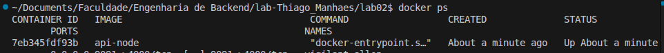
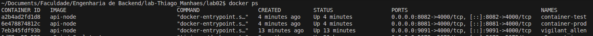
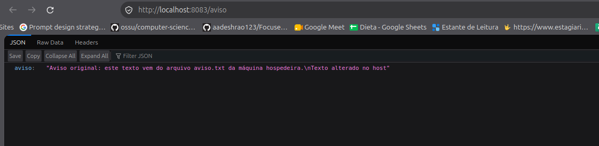
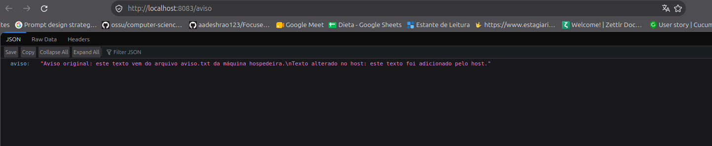

# 🐳 Laboratório Prático: Docker (Portas, Env e Volumes)

**Disciplina:** Engenharia de Aplicações Web Backend  
**Aluno:** Thiago Manhães da Conceição
  

---

## 🎯 Passo 1: Mapeamento de Portas
**Objetivo:** Compreender a diferença entre a porta do host e a porta do container.

- **Comando executado para subir o container (`container-portas`):**
```bash
docker build -t api-node .
docker run -p 9090:4000 api-node
```

- **Evidência (Print ou Saída do Terminal) do acesso em `http://localhost:9090`:**
### Observação: Usei a porta 9091 porque a porta 9090 do meu computador já está ocupada.


---

## 🎯 Passo 2: Variáveis de Ambiente (Configuração Dinâmica)
**Objetivo:** Demonstração do padrão *The Twelve-Factor App* injetando comportamentos diferentes na mesma imagem.

- **Comandos executados para subir os containers (`container-prod` e `container-test`):**
```bash
docker run -d --name container-prod -p 8081:4000 -e APP_MESSAGE="Ambiente de produção" api-node
docker run -d --name container-test -p 8082:4000 -e APP_MESSAGE="Ambiente de testes" api-node
```

- **Evidência do acesso em `http://localhost:8081/info` (Produção):**
- **Evidência do acesso em `http://localhost:8082/info` (Testes):**


*(Opcional)* **Utilizou o arquivo `.env`? Descreva brevemente como foi feito:**
> Não é necessário usar um arquivo .env. Ele poderia ser usado para fazer a injeção de configurações externas através de variáveis de ambiente, isso seria especialmente útil se esse processo de subir os containers fosse feito via script, mas não é o caso, eu fiz tudo executando comandos no terminal. 

---

## 🎯 Passo 3: Volumes e Bind Mounts
**Objetivo:** Leitura de dados do sistema hospedeiro em tempo real sem reconstruir a imagem.

- **Comando executado para subir o container com o volume (`container-volume`):**
```bash
docker run -d --name container-volume -p 8083:4000 -v "$(pwd)/dados:/usr/src/app/dados" api-node
```

- **Evidência 1: Acesso em `http://localhost:8083/aviso` (Texto Original):**


- **Evidência 2: Acesso em `http://localhost:8083/aviso` (Após alterar o arquivo `aviso.txt` localmente):**


---

## 🛡️ Passo 4: Análise Teórica e Boas Práticas (.dockerignore)

**Justifique, sob uma visão arquitetural de CI/CD, por que é crítico ignorar arquivos locais (como `.env`, `aviso.txt` e pastas de `dados/`) na construção da imagem utilizando o `.dockerignore`:**

> No nível mais prático, porque isso reduz o risco de que arquivos locais desnecessários sejam enviados como build. Isso reduz o risco de senhas, tokens ou chaves de acesso na imagem, onde os dados seriam expostos a quem tivesse acesso a ela. Em um nível de desenho de projeto, dependências externas não devem se misturar com implementações, o que faz parte da configuração externa, como a do ambiente de execução, não deve fazer parte ou possuir dependência de qualquer tipo com o que é implementação real.
